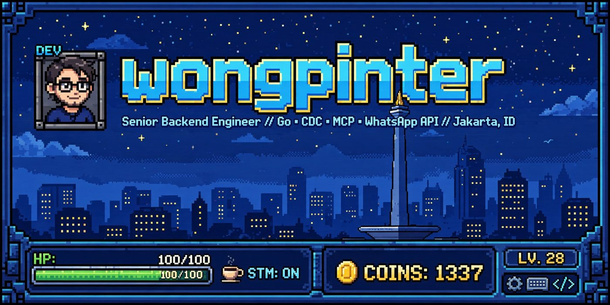

# 👋 Hi, I'm Sugeng (Wongpinter)

**Senior Backend Engineer · 12+ years · Jakarta, Indonesia**

I build systems that move data reliably — API gateways, real-time pipelines, change-data-capture, message brokers, CLI tools, and AI agents. Go is my daily driver, and I ship production code in Python, TypeScript, PHP, and Dart.

> Currently hacking on **[MemoDirector](https://github.com/wongpinter/MemoDirector)** (local-first PAO memory trainer — live at [memodirector.web.app](https://memodirector.web.app)), **[GDM](https://github.com/wongpinter/gdm)** (Go download manager), and **[audiobook-organizer](https://github.com/wongpinter/audiobook-organizer)** (metadata-driven media library organizer).

  
  
  
  
  

---

<!-- cool-readme:start -->

  <picture>
    <source media="(prefers-color-scheme: dark)" srcset="https://raw.githubusercontent.com/wongpinter/wongpinter/cards/summary-dark.svg">
    
  </picture>
  <picture>
    <source media="(prefers-color-scheme: dark)" srcset="https://raw.githubusercontent.com/wongpinter/wongpinter/cards/languages-dark.svg">
    
  </picture>

  <picture>
    <source media="(prefers-color-scheme: dark)" srcset="https://raw.githubusercontent.com/wongpinter/wongpinter/cards/weekly-dark.svg">
    
  </picture>

<!-- cool-readme:end -->

---

## 🏆 Projects that sell

Production-grade tools and libraries — systems programming, data plumbing, and developer tooling.

| Project | What it does | Stack |
|---------|--------------|-------|
| [walstream](https://github.com/wongpinter/walstream) | Change Data Capture (CDC) tool that tails PostgreSQL WAL and streams changes to message brokers | `Go` `PostgreSQL` `RabbitMQ` |
| [agent-property-mcp](https://github.com/wongpinter/agent-property-mcp) | Production-ready Model Context Protocol (MCP) server in Go, multiple transports | `Go` `MCP` |
| [gdm](https://github.com/wongpinter/gdm) | Terminal download manager with segmented HTTP and BitTorrent support | `Go` `BitTorrent` |
| [go-whatsapp](https://github.com/wongpinter/go-whatsapp) | Type-safe Go library for the WhatsApp Business Cloud API — messaging, webhooks, templates, flows | `Go` |
| [komiyomi-ext](https://github.com/wongpinter/komiyomi-ext) | Production Android manga, comic (CBZ/CBR), EPUB, and PDF reader with source extensions | `Kotlin` `Android` |
| [ketawa-reader-app](https://github.com/wongpinter/ketawa-reader-app) | Distraction-free, offline-first Android reader for Ketawa.com humor archive with dual-language i18n | `Kotlin` `Jetpack Compose` `Room` |
| [MemoDirector](https://github.com/wongpinter/MemoDirector) | Local-first PAO memory system builder — AI casting, Anki export, Light Studio design. Live: [memodirector.web.app](https://memodirector.web.app) | `TypeScript` `React 19` `Gemini` |
| [inktrace](https://github.com/wongpinter/inktrace) | Handwriting worksheet generator with in-browser HTML5 canvas and print-ready PDF export | `TypeScript` `Canvas` |
| [godoo](https://github.com/wongpinter/godoo) | Odoo XML-RPC wrapper — adopted across 50+ production deployments | `Go` `XML-RPC` |
| [gosh](https://github.com/wongpinter/gosh) | Configurable SSH server framework: auth, command handling, logging | `Go` `SSH` |
| [pi-livecraft](https://github.com/wongpinter/pi-livecraft) | Craft your own Pi client while it runs — HTML-enhanced Pi workflows | `TypeScript` |
| [clipush](https://github.com/wongpinter/clipush) | Simple CLI tool to save raw screenshots to a remote server | `Go` |

**Explore more:** [webnovel-scraper](https://github.com/wongpinter/webnovel-scraper) · [manga-dl](https://github.com/wongpinter/manga-dl) · [yet-another-lm-extractor](https://github.com/wongpinter/yet-another-lm-extractor) · [komiyomi](https://github.com/wongpinter/komiyomi) · [pantryku](https://github.com/wongpinter/pantryku)

## 🔒 Private / Internal Projects

Production systems, architecture research, and client implementations.

| Project | What it does | Stack |
|---------|--------------|-------|
| CRM Backend | Multi-module CRM API: customer management, payments, order/integration flows | `Go` |
| WhatsApp Gateway | Production messaging gateway: planning, integrations, WhatsApp Business API flows | `Go` |
| AI Customer Service Agents | MCP agent + LLMs integrated with the WhatsApp Meta API; automates ~80% of routine inquiries | `Python` `MCP` `LLM` |
| OmniSport | Sports facility management platform with hexagonal architecture | `Go` `Hexagonal` |
| Resonance | React web application | `React` `TypeScript` |
| Connect Words | Browser-based word puzzle game | `JavaScript` |
| Tetris 3D | 3D Tetris rendered in the browser | `JavaScript` |
| DapurKu Go | Household pantry, inventory, shopping & price tracking backend; successor to PantryKu | `Go` `PostgreSQL` `Redis` |
| Bank Soal | Family question-bank: phone-photo hardcopy → Gemini Flash → markdown → AI practice questions | `TypeScript` `KaTeX` `Gemini` |
| Apothecary App | Indonesian apotek & digital-health research + WhatsApp gateway for pharmacy flows | `Go` |
| sregep-bot | Serverless Telegram worklog bot with analytics + GitHub/Jira sync | `TypeScript` `Cloudflare Workers` |
| Agent Memory (Memory Pi) | Persistent memory layer for AI agents: dense embeddings, importance-weighted recall, multi-agent orchestration | `Python` `MCP` `Embeddings` |
| GadaiKu | Privacy-first, offline-first pawn & gold asset tracker for Indonesia: dual engine (KCA + Syariah Rahn), gold appraisal | `Flutter` `Isar` `Riverpod` |
| Connect Word (Godot) | Ad-free word grouping puzzle — rows of 4–5 words lock when their theme matches · Godot 4.3 | `GDScript` `Godot 4.3` |
| Kid Platformer | 2D platformer character with NES-style 64×64 animations (run/idle/jump/fall/attack) + state machine | `GDScript` `Godot 4` |
| Platformer Controller | State-machine CharacterBody2D controller — wall slide/latch, dash, roll, crouch, ground pound | `GDScript` `Godot 4.2` |

## 🤝 Open Contributions

- **[hermes-agent-self-evolution](https://github.com/NousResearch/hermes-agent-self-evolution)** — Evolutionary self-improvement research for Hermes Agent (Python).

---

## 🗺️ Language Diversity

I write production code in a broad range of languages — here's what each one ships:

| Language | Where I use it |
|----------|----------------|
| **Go** | Primary language — gdm, walstream (CDC), godoo, go-whatsapp, gosh, MCP servers, scrapers, queue services |
| **Python** | FastAPI + Django services, webnovel-scraper, manga-dl, AI/LLM tooling, agent memory |
| **TypeScript / JavaScript** | React / Next.js apps, Cloudflare Workers, Chrome extensions, canvas tools |
| **PHP** | Laravel / Lumen APIs, SOAP clients, Google Directory integration |
| **Dart / Flutter** | Cross-platform mobile apps (pantryku, StoryGrabber mobile, GadaiKu pawn tracker) |
| **Kotlin** | Native Android (komiyomi-ext, ketawa-reader-app) |
| **GDScript / Godot** | Game dev — Connect Word (puzzle), Kid Platformer (NES-style 2D), Platformer Controller — Godot 4.2–4.3 |
| **Rust** | Learning & systems programming |
| **Shell / Lua** | Dotfiles, dev-server bootstrap, automation |

---

## 📫 Find Me

- 🌐 **Website:** [wongpinter.com](https://wongpinter.com)
- 💼 **LinkedIn:** [linkedin.com/in/sugengs](https://www.linkedin.com/in/sugengs/)
- 🐦 **X (Twitter):** [@the_wongpinter](https://twitter.com/the_wongpinter)
- ✉️ **Email:** [the.wongpinter@gmail.com](mailto:the.wongpinter@gmail.com)
- 📄 **Resume / CV:** [Download CV (PDF)](Wongpinter-CV.pdf)

> Open to freelance backend / API / automation & AI-agent work. Jakarta timezone (WIB / UTC+7), remote-friendly.

---

  <i>"The best code is the code never written. The second best ships Friday."</i>

